# Розпізнавання страв за фотографією

Розділ описує другу модель машинного навчання системи Kolos. Це згорткова нейронна мережа, яка за
фотографією тарілки визначає страву. Користувач фотографує їжу, отримує кілька найімовірніших
варіантів і вибирає потрібний. Так запис у щоденник харчування займає секунди, а не пошук
продукту в каталозі.

Усі числа в розділі взято з файлів `results/*.json`, рисунки лежать у `figures/`. Код
експерименту розташований у `ml/foodphoto/`, порядок запуску описано в `ml/README.md`.

**Основний результат.** Мережа EfficientNet-B0, попередньо навчена на ImageNet і повністю
донавчена на 108 класах (101 клас Food-101 і 7 українських страв), правильно визначає страву
на 87,0 % тестових фото Food-101 і на 88,6 % тестових фото українських страв. Правильна
страва потрапляє в перші три варіанти відповідно у 95,6 % і 96,2 % випадків. У застосунку
модель працює через ONNX Runtime і разом з обробкою фото відповідає за 27 мс без GPU.

## Зміст

1. [Постановка задачі](#1-постановка-задачі)
2. [Дані](#2-дані)
3. [Методика](#3-методика)
4. [Перебіг навчання](#4-перебіг-навчання)
5. [Порівняння моделей](#5-порівняння-моделей)
6. [Аналіз результатів основної моделі](#6-аналіз-результатів-основної-моделі)
7. [Упевненість моделі та вибір кількості варіантів](#7-упевненість-моделі-та-вибір-кількості-варіантів)
8. [Швидкодія](#8-швидкодія)
9. [Використання моделі в системі](#9-використання-моделі-в-системі)
10. [Висновки](#10-висновки)
11. [Обмеження](#11-обмеження)
12. [Відтворення](#12-відтворення)
13. [Література](#13-література)

## 1. Постановка задачі

- **Тип задачі:** багатокласова класифікація зображень, 108 класів.
- **Вхід:** кольорова фотографія страви, яка зводиться до 224 × 224 пікселів.
- **Вихід:** розподіл імовірностей за класами. Застосунок показує кілька найімовірніших
  класів.
- **Метрики:**
  - top-1 — частка фото, для яких найімовірніший клас правильний;
  - top-k — частка фото, для яких правильний клас серед перших k варіантів.
  
  Top-k важлива тому, що користувач вибирає страву зі списку варіантів, а не отримує одну
  відповідь.
- **Чому потрібні власні дані.** Найпоширеніший відкритий набір фотографій страв, Food-101
  [1], складено з популярних страв західних і азійських кухонь. Страв, які щодня їдять
  користувачі в Україні (борщ, вареники, деруни тощо), у ньому немає, і відкритого набору
  фотографій української кухні теж немає. Тому набір українських страв було зібрано в межах
  роботи (підрозділ 2.2).

**Підхід: перенесення навчання (transfer learning).** Мережу не навчають з нуля, а беруть
згорткову мережу з вагами, навченими на ImageNet [4] (1,28 млн зображень, 1000 класів). Ранні
шари такої мережі вже розпізнають загальні ознаки зображень: краї, текстури, форми. Їх
достатньо лише пристосувати до нової задачі [12, 13]. Це дає змогу отримати високу точність
на кількох сотнях фото на клас, а навчання займає годину на безкоштовному GPU Google Colab.

Порівнюються дві архітектури, розроблені для пристроїв з обмеженими ресурсами:

- **EfficientNet-B0** [2] — 4,2 млн параметрів, масштабована мережа з блоками MBConv та
  squeeze-and-excitation;
- **MobileNetV3-Large** [3] — 4,3 млн параметрів, мережа, знайдена автоматичним пошуком
  архітектури з урахуванням затримки на мобільних процесорах.

## 2. Дані

### 2.1. Food-101

Food-101 [1] містить 101 000 фотографій 101 страви, по 1000 на клас, із сайту foodspotting.com.
Автори набору задали офіційний поділ: 750 навчальних і 250 тестових фото на клас. Навчальні
фото навмисно не чистили, тому частина з них має неточні мітки. Тестові фото перевірено вручну.

Офіційний тестовий поділ збережено без змін, тож результати можна порівнювати з
опублікованими. Для вибору найкращої епохи з навчальних фото кожного класу відкладено 50 у
валідаційну вибірку. Фото вибирались детерміновано, за хешем ідентифікатора зображення.

*Таблиця — Поділ Food-101 на вибірки*

| Вибірка | На клас | Усього |
|---|---:|---:|
| Навчальна | 700 | 70 700 |
| Валідаційна | 50 | 5 050 |
| Тестова | 250 | 25 250 |

### 2.2. Українські страви

**Джерело.** Фотографії взято з Wikimedia Commons, найбільшого відкритого сховища фото з
вільними ліцензіями. Для кожної страви задано категорії Commons, наприклад «Borscht»,
«Ukrainian borscht», «Varenyky», «Pierogi». Усі файли цих категорій і їхніх підкатегорій
отримано через MediaWiki API (`ml/foodphoto/commons.py`). Правила відбору:

- лише фотографії у форматах JPEG, PNG, WebP із коротшою стороною від 224 пікселів;
- файл, який трапився в категоріях двох різних страв, відкидається, бо його мітка
  неоднозначна;
- кожне фото переглянуто вручну за контактними аркушами (сітки з пронумерованих мініатюр).

Під час ручного перегляду відкинуто 1 209 файлів. Відкидалися:

- фото процесу приготування й сирих інгредієнтів;
- фото людей, ресторанів, фестивалів, поштових марок і упаковок;
- фото інших страв.

Для борщу залишено лише червоний борщ у тарілці. Категорія Commons охоплює всю родину супів:
білий жур, зелений щавлевий, холодний свекольник. Ці страви виглядають зовсім інакше й
заважали б моделі. Список відкинутих файлів із причинами збережено в
`ml/foodphoto/review.json`, тож перегляд можна відтворити.

**Які страви увійшли.** Сім страв мають щонайменше 40 придатних фото: борщ, вареники, голубці,
деруни, салат олів'є, паска і шашлик. Інші страви перевірено, але до набору вони не увійшли:

- до ручного перегляду на Commons знайшлося менш як 40 фото: сирники 30, налисники 39,
  котлета по-київськи 25, пампушки 9, гречана каша 12, холодець 6;
- після ручного перегляду лишилося замало придатних фото: пиріжки (~34) і пельмені (~30).
  У цих категоріях переважають фото магазинів, упаковок і вуличних свят.

**Ліцензії.** Усі 879 фото мають вільні ліцензії:

*Таблиця — Ліцензії фотографій українських страв*

| Ліцензія | Фото |
|---|---:|
| CC BY-SA 4.0 | 451 |
| CC BY-SA 3.0 | 120 |
| CC0 | 65 |
| CC BY 4.0 | 58 |
| Інші CC BY / BY-SA і суспільне надбання | 185 |

Ліцензії CC BY та BY-SA вимагають зазначати автора. Автора, ліцензію та посилання на кожне фото
записано в `ua_sources.csv`. Для фото, показаних на рисунках 2 і 7, ці дані окремо зібрано в
`results/figure_photo_sources.csv`.

**Поділ.** Українські фото поділено детерміновано за хешем назви файлу:

*Таблиця — Поділ фотографій українських страв на вибірки*

| Вибірка | Частка | Фото |
|---|---:|---:|
| Навчальна | 65 % | 557 |
| Валідаційна | 15 % | 138 |
| Тестова | 20 % | 184 |

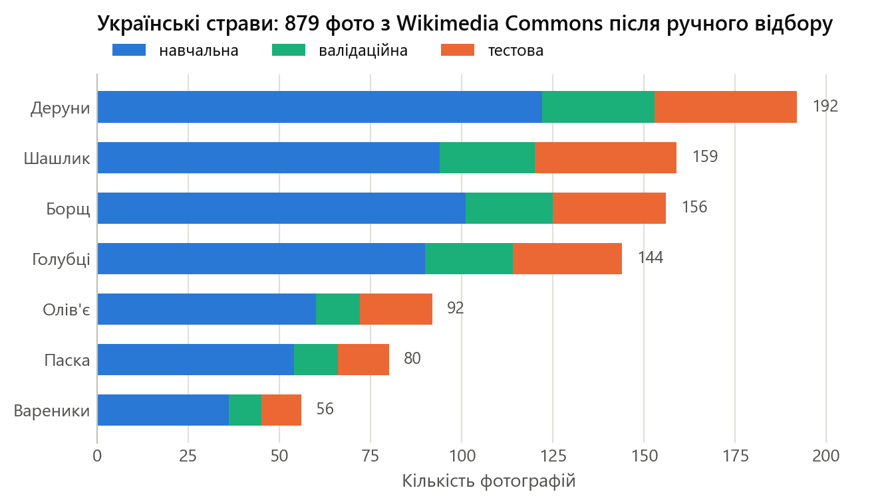

*Рисунок 1 — Кількість фотографій українських страв за вибірками.*

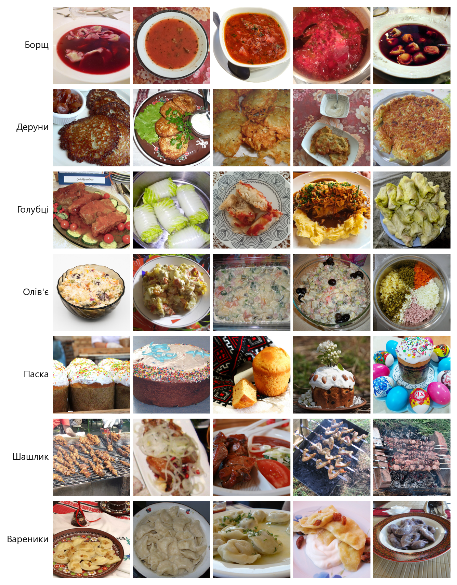

*Рисунок 2 — Приклади навчальних фотографій: по п'ять на страву. Автори й ліцензії наведено
в `results/figure_photo_sources.csv`.*

На рисунку 2 видно, наскільки різноманітні ці фото: домашня й ресторанна подача, різні
тарілки, освітлення й ракурси. Голубці бувають у листі білокачанної, савойської та пекінської
капусти, паска буває з глазур'ю й без неї. Модель має навчитися впізнавати страву за всіх цих
варіантів.

**Дисбаланс класів.** На один клас Food-101 у навчальній вибірці припадає 700 фото, а на
українську страву — від 36 (вареники) до 122 (деруни), у середньому 80. Тобто українських фото
в 6–19 разів менше. Якщо нічого не робити, модель рідше бачить українські страви й рідше їх
передбачає. Як це компенсується, описано в підрозділі 3.3.

### 2.3. Попередня обробка

Перед навчанням усі фото один раз зменшено так, щоб коротша сторона мала 256 пікселів, і
збережено у JPEG (`ml/foodphoto/prepare.py`). Так набір займає 2 ГБ замість 5 ГБ, а читання
з диска не гальмує навчання на GPU.

## 3. Методика

### 3.1. Модель

Беруться ваги, навчені на ImageNet: `IMAGENET1K_V1` для EfficientNet-B0 і `IMAGENET1K_V2` для
MobileNetV3-Large з бібліотеки torchvision [16]. Останній повнозв'язний шар мережі
(1000 виходів ImageNet) замінено новим шаром на 108 виходів. Його ваги ініціалізуються
випадково.

### 3.2. Експерименти

Поставлено чотири експерименти. Кожен відповідає на одне запитання:

*Таблиця — Експерименти*

| Запуск | Архітектура | Що навчається | Балансування | Епох | Запитання |
|---|---|---|---|---:|---|
| `effb0_finetune` | EfficientNet-B0 | уся мережа | так | 12 | основна модель |
| `effb0_probe` | EfficientNet-B0 | лише новий шар | так | 6 | чи достатньо ознак з ImageNet без донавчання? |
| `mnv3_finetune` | MobileNetV3-Large | уся мережа | так | 12 | чи не дасть легша мережа ту саму точність? |
| `effb0_nobalance` | EfficientNet-B0 | уся мережа | ні | 12 | чи потрібне балансування класів? |

Окремо використано два запуски, які навчалися лише на 101 класі Food-101, з тими самими
налаштуваннями. З ними порівнюється, чи погіршують сім нових класів точність на Food-101
(підрозділ 5.4).

### 3.3. Налаштування навчання

*Таблиця — Налаштування навчання*

| Параметр | Значення |
|---|---|
| Оптимізатор | AdamW [5], weight decay 0,05 |
| Швидкість навчання | 1·10⁻³ для нового шару; 3·10⁻⁴ (×0,3) для решти мережі. У `effb0_probe` 3·10⁻³ |
| Розклад | лінійний розігрів протягом 1 епохи, далі косинусне згасання до нуля [6] |
| Розмір пакета | 64 |
| Функція втрат | крос-ентропія зі згладжуванням міток 0,1 [7] |
| Аугментація | RandomResizedCrop 224 (масштаб 0,35–1), горизонтальне віддзеркалення, TrivialAugment [9] |
| Оцінювання | зменшення до 256, центральне вирізання 224 × 224 |
| Точність обчислень | змішана (float16 / float32) [15] |
| Вибір моделі | епоха з найкращою top-1 на валідаційній вибірці |
| Апаратне забезпечення | GPU Google Colab, PyTorch 2 [16] |

Обґрунтування окремих рішень:

- **Менша швидкість навчання для попередньо навчених шарів.** Новий шар починає з випадкових
  ваг, і на початку його градієнти великі. Якщо оновлювати решту мережі з тією самою
  швидкістю, корисні ознаки з ImageNet можна зруйнувати в перших кроках. Розігрів працює в
  тому самому напрямі.
- **Згладжування міток.** Частина навчальних фото Food-101 має неточні мітки (підрозділ 2.1).
  Згладжування не дає моделі бути абсолютно впевненою в мітці, тож вона менше запам'ятовує
  такі помилки.
- **Аугментація.** Випадкові вирізання, віддзеркалення та зміни кольору й контрасту імітують
  різні ракурси, освітлення й камери. Для українських страв це особливо важливо, бо на страву
  є лише 36–122 навчальні фото.
- **Балансування класів.** Фото для навчальних пакетів вибираються з імовірністю, пропорційною
  1 / n^0,5, де n — кількість фото класу. Показник 0,5 дає компроміс:
  - при показнику 1 усі класи траплялися б однаково часто, і кожне фото вареників
    повторювалося б в епосі майже 20 разів. Це веде до перенавчання;
  - при показнику 0 вибірка лишається природною, і українські страви трапляються рідко.

  Чи виправдане це рішення, перевіряє запуск `effb0_nobalance`.
- **Відтворюваність.** Порядок вибірки в кожній епосі задається фіксованим зерном. Чекпойнт
  зберігається після кожної епохи, тому навчання, перерване відключенням Colab, продовжується
  з того самого місця.

### 3.4. Статистична перевірка

Усі моделі оцінюються на одних і тих самих тестових фото, тож різницю між двома моделями
перевіряють точним тестом Мак-Немара [11]. Тест враховує лише фото, на яких одна модель
відповіла правильно, а інша помилилася. Різниця вважається значущою при p < 0,05.

Для кожної точності наведено 95 % довірчий інтервал. Його оцінено методом бутстрепу [14]:
2 000 повторних вибірок тестових фото з поверненням. На 184 українських фото інтервал має
ширину близько ±5 відсоткових пунктів (в. п.). Тому невеликі різниці на цьому піднаборі слід
оцінювати лише за тестом, а не за самими числами.

## 4. Перебіг навчання

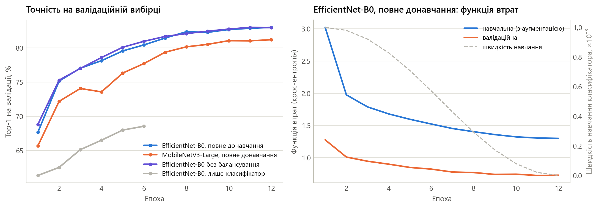

*Рисунок 3 — Ліворуч: top-1 на валідаційній вибірці за епохами для чотирьох запусків.
Праворуч: функція втрат основної моделі та швидкість навчання.*

- Повне донавчання EfficientNet-B0 вже після першої епохи дає 67,7 % на валідації. Далі
  точність зростає до 83,0 % на 12-й епосі. Найкраща модель — з останньої епохи: при
  косинусному розкладі останні епохи з малою швидкістю навчання доводять модель до кінця.
- MobileNetV3-Large увесь час іде на 1,8–4,5 в. п. нижче. Вона також менш стабільна: на 4-й
  епосі точність тимчасово падає.
- Модель, у якій навчався лише останній шар, досягає лише 68,5 % за 6 епох, і її зростання
  вже сповільнюється. Ознак з ImageNet без донавчання недостатньо, щоб розрізняти схожі страви.
- Функція втрат на навчальній вибірці вища, ніж на валідаційній. Це не помилка: навчальні фото
  проходять сильну аугментацію, а до міток застосовано згладжування, тож мінімально можлива
  втрата на них вища. Перенавчання немає, бо валідаційна втрата не зростає до кінця навчання.

Одна епоха основної моделі триває близько 5,5 хв, усе навчання — 67 хв.

*Таблиця — Найкраща епоха і час навчання*

| Запуск | Найкраща епоха | Час навчання, хв |
|---|---:|---:|
| EfficientNet-B0, повне донавчання | 12 | 66,6 |
| MobileNetV3-Large, повне донавчання | 12 | 61,8 |
| EfficientNet-B0 без балансування | 11 | 65,8 |
| EfficientNet-B0, лише класифікатор | 6 | 27,6 |

## 5. Порівняння моделей

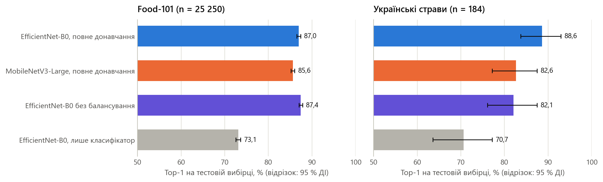

*Рисунок 4 — Top-1 на тестовій вибірці окремо для Food-101 і для українських страв;
відрізки — 95 % довірчі інтервали.*

*Таблиця — Точність на тестовій вибірці, % (у дужках 95 % довірчий інтервал)*

| Модель | Food-101, top-1 | Food-101, top-5 | Українські, top-1 | Українські, top-5 |
|---|---:|---:|---:|---:|
| **EfficientNet-B0, повне донавчання** | **87,0** (86,5–87,4) | 97,4 | **88,6** (83,7–92,9) | **97,3** |
| MobileNetV3-Large, повне донавчання | 85,6 (85,2–86,0) | 97,0 | 82,6 (77,2–87,5) | 96,7 |
| EfficientNet-B0 без балансування | **87,4** (87,0–87,8) | **97,6** | 82,1 (76,1–87,5) | 96,7 |
| EfficientNet-B0, лише класифікатор | 73,1 (72,6–73,6) | 92,3 | 70,7 (63,6–77,2) | 90,2 |

*Таблиця — Попарні порівняння (точний тест Мак-Немара)*

| Порівняння | Піднабір | Різниця top-1, в. п. | Лише A прав. | Лише B прав. | p |
|---|---|---:|---:|---:|---:|
| A: повне донавчання, B: лише класифікатор | Food-101 | +13,9 | 4 117 | 614 | < 0,001 |
| | українські | +17,9 | 37 | 4 | < 0,001 |
| A: EfficientNet-B0, B: MobileNetV3-Large | Food-101 | +1,4 | 1 268 | 923 | < 0,001 |
| | українські | +6,0 | 13 | 2 | 0,007 |
| A: з балансуванням, B: без балансування | Food-101 | −0,5 | 685 | 800 | 0,003 |
| | українські | +6,5 | 16 | 4 | 0,012 |
| A: 108 класів, B: 101 клас (EfficientNet-B0) | Food-101 | −0,1 | 796 | 830 | 0,41 |
| A: 108 класів, B: 101 клас (MobileNetV3) | Food-101 | −0,4 | 808 | 910 | 0,015 |

### 5.1. Донавчання всієї мережі проти навчання лише класифікатора

Повне донавчання дає на 13,9 в. п. більше на Food-101 і на 17,9 в. п. більше на українських
стравах. Різниця значуща. Ознаки ImageNet описують об'єкти загалом. Для страв потрібні тонші
ознаки: текстура тіста, начинка, соус. Отримати їх можна, лише змінивши ваги самої мережі. Це
узгоджується з результатами [13]: на наборах із «тонкими» відмінностями між класами повне
донавчання значно перевершує лінійний класифікатор над замороженими ознаками.

### 5.2. EfficientNet-B0 проти MobileNetV3-Large

Мережі мають майже однакову кількість параметрів, але EfficientNet-B0 точніша:

- на Food-101 — на 1,4 в. п.;
- на українських стравах — на 6,0 в. п.

Обидві різниці значущі. MobileNetV3 натомість на третину швидша (підрозділ 8). При 28 мс на
фото швидкості EfficientNet-B0 цілком достатньо, тож основною моделлю обрано її.

### 5.3. Балансування класів

Без балансування модель трохи краща на Food-101: +0,5 в. п., різниця значуща. Проте на
українських стравах вона гірша на 6,5 в. п. Модель рідше бачить українські страви під час
навчання, тому стає «обережною» і передбачає їх лише за дуже явних ознак:

*Таблиця — Вплив балансування класів*

| Показник | Без балансування | З балансуванням |
|---|---:|---:|
| Фото Food-101 (з 25 250), віднесені до української страви | 37 | 102 |
| Частка правильно впізнаних українських страв | 82,1 % | 88,6 % |

Для застосунку важливіше впізнати борщ на фото користувача, ніж уникнути зрідка запропонованого
борщу на фото карі: користувач однаково вибирає страву зі списку. Тому залишено модель з
балансуванням. Ціна цього — 0,5 в. п. на Food-101.

### 5.4. Чи шкодять нові класи точності на Food-101

Модель EfficientNet-B0 на 108 класах, порівняно з такою самою моделлю, навченою лише на
101 класі Food-101:

*Таблиця — Точність на Food-101 залежно від кількості класів*

| Модель | Food-101, top-1 |
|---|---:|
| 101 клас | 87,1 % |
| 108 класів | 87,0 % |

Різниця −0,1 в. п. незначуща (p = 0,41). Отже, сім українських класів додано без втрат для
решти. Для MobileNetV3 втрата трохи більша: −0,4 в. п., p = 0,015.

Для порівняння з опублікованими результатами на Food-101:

*Таблиця — Порівняння з опублікованими результатами на Food-101*

| Робота | Модель | Top-1 |
|---|---|---:|
| Автори набору [1] | випадкові ліси над локальними ознаками | 50,8 % |
| Автори EfficientNet [2] | EfficientNet-B7, у 12 разів більша за B0, зображення 600 × 600 | 93,0 % |
| Ця робота | EfficientNet-B0, зображення 224 × 224, 12 епох на безкоштовному GPU | 87,0 % |

## 6. Аналіз результатів основної моделі

### 6.1. Українські страви

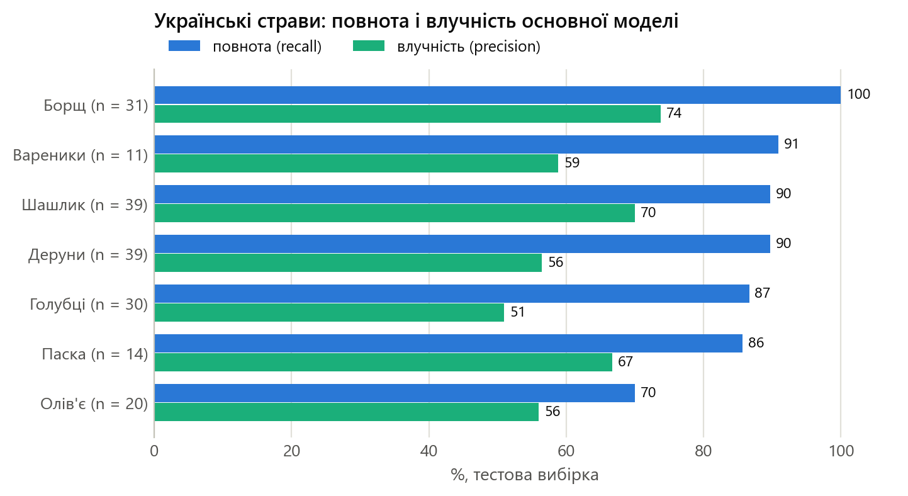

*Рисунок 5 — Повнота (частка фото страви, впізнаних правильно) та влучність (частка
правильних серед усіх відповідей «ця страва») для кожної української страви.*

*Таблиця — Результати основної моделі для українських страв*

| Страва | Тестових фото | Повнота | Влучність | Top-5 |
|---|---:|---:|---:|---:|
| Борщ | 31 | 100 % | 74 % | 100 % |
| Вареники | 11 | 91 % | 59 % | 91 % |
| Деруни | 39 | 90 % | 56 % | 95 % |
| Шашлик | 39 | 90 % | 70 % | 97 % |
| Голубці | 30 | 87 % | 51 % | 100 % |
| Паска | 14 | 86 % | 67 % | 100 % |
| Олів'є | 20 | 70 % | 56 % | 95 % |

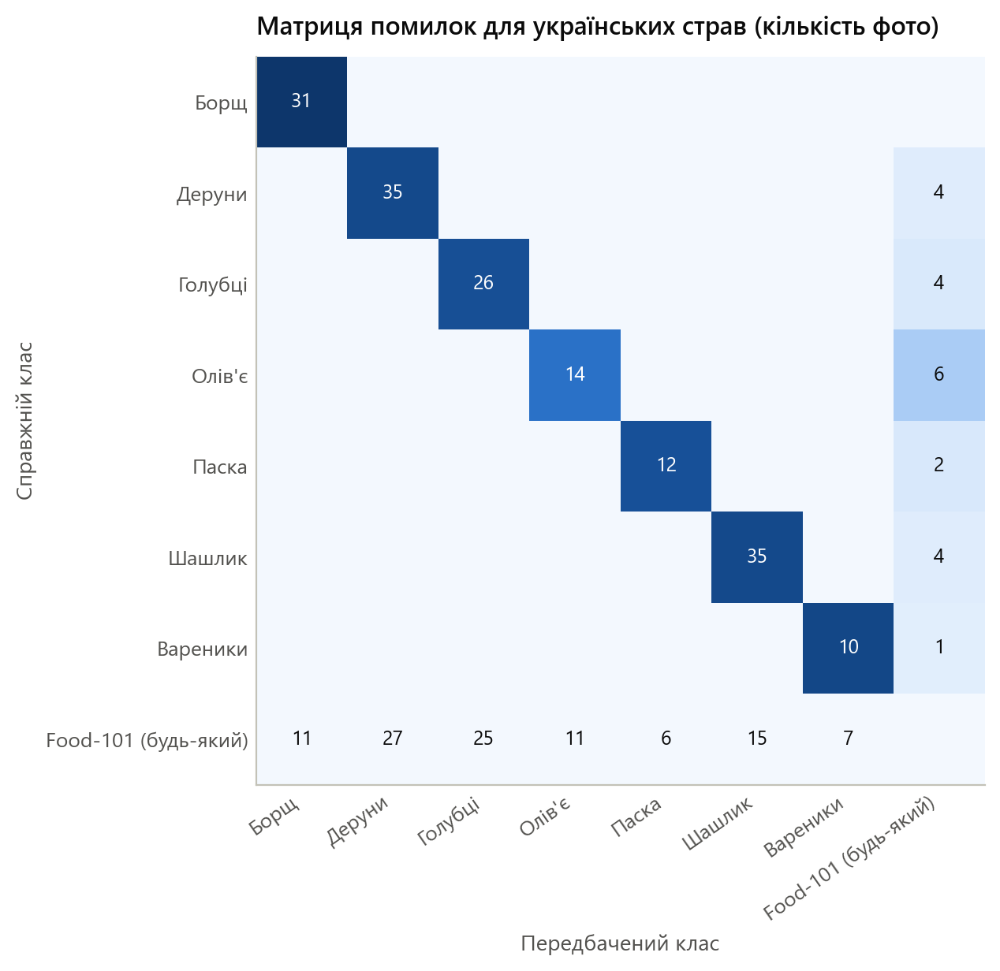

*Рисунок 6 — Матриця помилок для українських страв. Останній стовпець — фото української
страви, віднесені до будь-якого класу Food-101. Останній рядок — фото Food-101, віднесені до
української страви.*

Що показує матриця помилок:

1. **Українські страви між собою модель не плутає.** Усі 21 помилка на українських фото — це
   віднесення до якогось класу Food-101. Сім страв мають чіткі візуальні відмінності:
   - колір борщу;
   - форма вареників;
   - зелений лист голубців;
   - смажена скоринка дерунів;
   - кубики олів'є;
   - висока циліндрична паска;
   - шампури шашлику.
2. **Найскладніша страва — олів'є** (70 %). Салати з майонезом схожі один на одного. Модель
   приймала олів'є за ризото, піцу, омлет, хумус і бутерброд з лобстером.
3. **Влучність нижча за повноту.** Причина в пропорціях тестової вибірки: на 184 українські
   фото припадає 25 250 фото Food-101. Навіть 0,4 % хибних спрацьовувань на Food-101
   (102 фото) — це більше половини всіх українських фото. Найчастіше:
   - фото карі (chicken curry) модель приймає за борщ (7 разів);
   - фото крабових котлет і омлету — за деруни.

   Ці помилки зрозумілі: червоний суп у мисці, смажені плескаті котлетки. У реальному
   користуванні частка українських страв на фото значно більша, ніж у цій тестовій вибірці,
   тож влучність буде вищою.

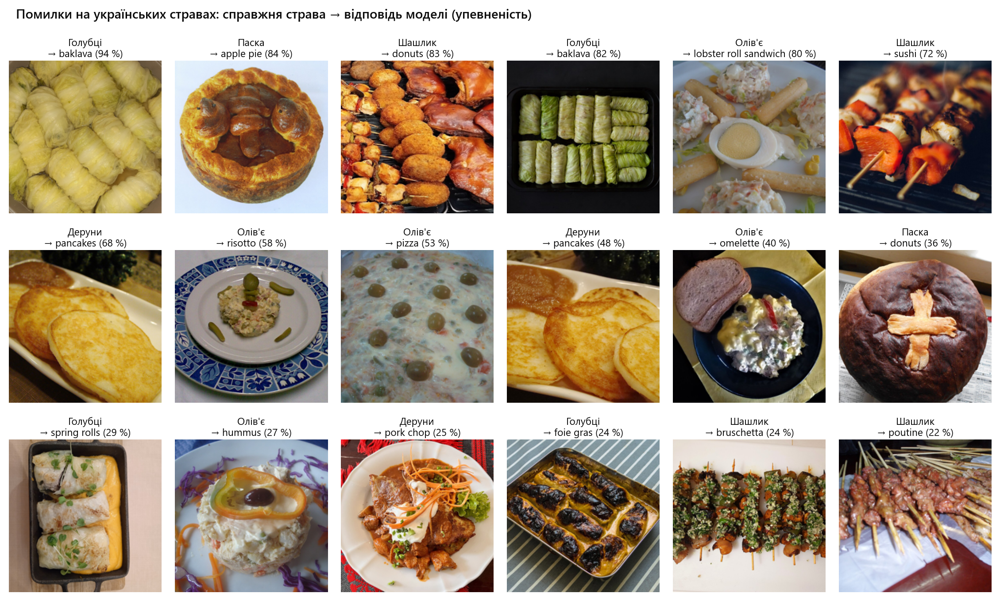

*Рисунок 7 — Помилки основної моделі на українських стравах, від найупевненіших. Над кожним
фото вказано справжню страву, відповідь моделі та її впевненість. Автори фото наведені в
`results/figure_photo_sources.csv`.*

Більшість помилок на рисунку 7 зрозуміла й людині:

- рулети з пекінської капусти, щільно складені рядами, нагадують пахлаву (baklava);
- шашлик з овочами на дерев'яних шпажках схожий на суші й брускети;
- деруни з картопляного пюре, гладкі й без скоринки, модель прийняла за панкейки;
- паска з хрестом із тіста схожа на пончик.

Частина помилок пов'язана з тим, як зроблено фото: страва з іншими продуктами на тарілці або
зовсім нетипова подача.

### 6.2. Класи Food-101

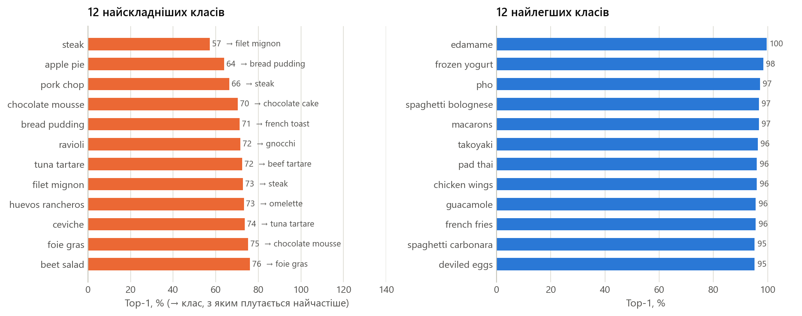

*Рисунок 8 — Дванадцять найскладніших і дванадцять найлегших класів Food-101 для основної
моделі. Біля складних класів вказано клас, з яким вони плутаються найчастіше.*

Точність на окремих класах Food-101 коливається від 57 % до 100 %. 47 зі 101 класу мають
точність не нижче 90 %. Найскладніші класи майже завжди мають візуально близького «двійника»:

*Таблиця — Найскладніші класи Food-101*

| Клас | Top-1 | Найчастіше плутається з |
|---|---:|---|
| steak | 57 % | filet mignon (34 фото з 250) |
| apple pie | 64 % | bread pudding |
| pork chop | 66 % | steak |
| chocolate mousse | 70 % | chocolate cake |

Це не вада моделі, а властивість самих класів: різні шматки смаженого м'яса або шоколадні
десерти часто не розрізнить і людина. Найлегші класи мають унікальний вигляд: едамаме, фо,
макаруни, такоякі. Для обліку харчування такі помилки здебільшого некритичні: стейк і філе
міньйон мають близьку харчову цінність.

## 7. Упевненість моделі та вибір кількості варіантів

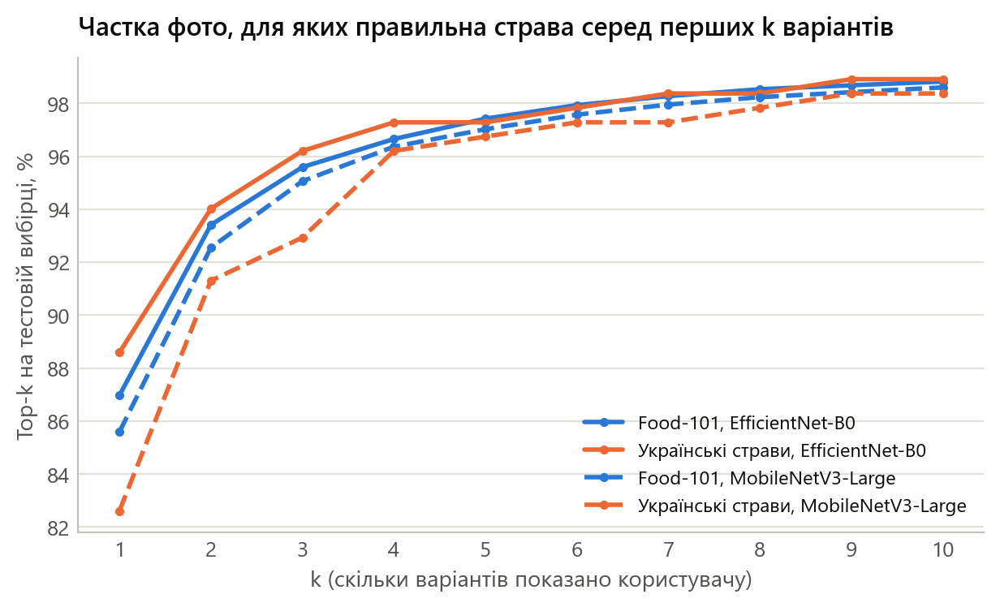

*Рисунок 9 — Частка фото, для яких правильна страва серед перших k варіантів.*

*Таблиця — Top-k основної моделі*

| k | Food-101 | Українські страви |
|---:|---:|---:|
| 1 | 87,0 % | 88,6 % |
| 2 | 93,4 % | 94,0 % |
| 3 | 95,6 % | 96,2 % |
| 5 | 97,4 % | 97,3 % |

Найбільший приріст дає другий варіант (+6,4 в. п.). Після третього крива майже виходить на
плато. Тому в застосунку доцільно показувати три варіанти: користувач отримує правильну страву
в ~96 % випадків, і список лишається коротким.

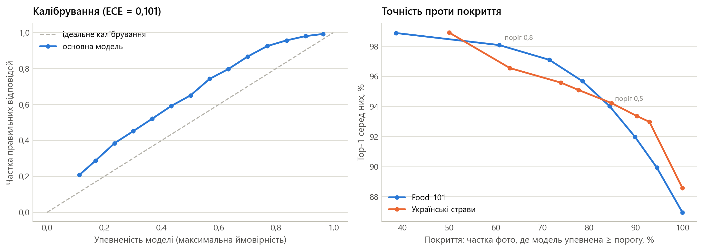

*Рисунок 10 — Ліворуч: діаграма надійності (reliability diagram). Праворуч: точність на фото,
де впевненість моделі не нижча за поріг, залежно від частки таких фото.*

**Калібрування.** Впевненість моделі (максимальна ймовірність) у середньому становить 76,9 %,
а частка правильних відповідей — 87,0 %. Отже, модель недооцінює себе: крива на рисунку 10
лежить вище діагоналі. Очікувана похибка калібрування (ECE) [10] дорівнює 0,101. Це відомий
наслідок згладжування міток [8]: модель навчається ніколи не давати ймовірність, близьку до 1.
Для застосунку це не проблема, бо впевненість використовується лише для порівняння з порогом,
а сам поріг підбирається на цих даних.

**Поріг упевненості:**

*Таблиця — Точність залежно від порогу впевненості*

| Поріг | Food-101: частка фото | Food-101: точність | Українські: частка фото | Українські: точність |
|---:|---:|---:|---:|---:|
| — | 100 % | 87,0 % | 100 % | 88,6 % |
| 0,5 | 84,4 % | 94,0 % | 84,8 % | 94,2 % |
| 0,8 | 60,8 % | 98,1 % | 63,0 % | 96,6 % |

Звідси випливає правило для інтерфейсу:

- якщо впевненість не нижча за 0,5, перший варіант позначається як найімовірніший. Він
  правильний у 94 % таких випадків, а таких фото 84 %;
- інакше застосунок показує три варіанти без позначки, і користувач вибирає сам або шукає
  страву в каталозі.

## 8. Швидкодія

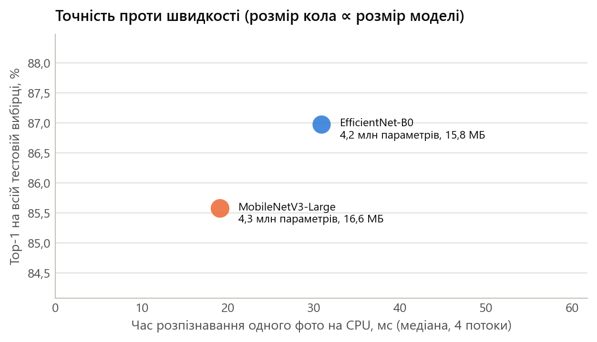

*Рисунок 11 — Точність на всій тестовій вибірці проти часу обробки одного фото на процесорі.*

Час виміряно на ноутбуці з процесором Intel 12-го покоління (4 потоки, PyTorch 2.11, CPU):
одне фото 224 × 224, 20 прогрівальних і 200 вимірюваних запусків. На ноутбуці час залежить від
режиму живлення, тож абсолютні значення орієнтовні, а співвідношення моделей стабільне.

*Таблиця — Розмір і швидкодія моделей*

| Модель | Параметрів | Розмір (float32) | Час на фото, медіана | 90-й перцентиль |
|---|---:|---:|---:|---:|
| EfficientNet-B0 | 4,15 млн | 15,8 МБ | 27,9 мс | 30,2 мс |
| MobileNetV3-Large | 4,34 млн | 16,6 МБ | 19,0 мс | 21,0 мс |

Обидві моделі невеликі й достатньо швидкі, щоб працювати на сервері застосунку без GPU.
Завантаження фото з телефону триває довше, ніж саме розпізнавання.

## 9. Використання моделі в системі

**Експорт.** Навчену мережу перетворено у формат ONNX (Open Neural Network Exchange),
`ml/foodphoto/export.py`. Це відкритий формат, у якому в одному файлі зберігаються і будова
мережі, і її ваги. Файл запускає бібліотека ONNX Runtime, тож серверу застосунку не потрібен
PyTorch. До мережі додано останній шар softmax, тому модель одразу повертає ймовірності класів.
Поруч записується файл `meta.json` з порядком класів, параметрами попередньої обробки та
порогом упевненості.

*Таблиця — Перевірка експортованої моделі*

| Перевірка | Результат |
|---|---|
| Розмір файлу `model.onnx` | 15,8 МБ |
| Найбільша різниця ймовірностей ONNX і PyTorch на 16 фото | 1·10⁻⁶ |
| Збіг найімовірнішого класу ONNX і PyTorch | 16 з 16 фото |
| Збіг відповідей з попередньою обробкою застосунку (PIL + NumPy) і навчальною (torchvision) | 16 з 16 фото |
| Час обробки одного фото: PyTorch / ONNX Runtime (4 потоки, CPU) | 30 мс / 8,6 мс |
| Повний запит у застосунку: декодування, зменшення, модель (2 потоки) | 27 мс |

ONNX Runtime обробляє фото у 3,5 раза швидше за PyTorch на тому самому процесорі. Тому
швидкості моделі вистачає для звичайного сервера без GPU.

**Зв'язок класів зі стравами в каталозі.** Модель повертає назву класу, а користувачу потрібна
страва з харчовою цінністю, яку можна записати в щоденник. Кожен зі 108 класів зіставлено з
однією стравою вбудованого каталогу (`seed_foods.PHOTO_FOODS`):

- 12 класів відповідають продуктам, які вже були в каталозі. Наприклад, `french_fries` — це
  «Картопля фрі», а `pizza` — «Піца з сиром»;
- для решти 96 класів у каталог додано страви. Харчову цінність узято з бази FNDDS (Food and
  Nutrient Database for Dietary Studies) Міністерства сільського господарства США, тієї самої
  FoodData Central, з якої взято дані для решти каталогу. FNDDS описує готові страви так, як їх
  їдять: «Pierogi», «Stuffed cabbage rolls with beef and rice», «Potato pancake». Для кожної
  страви є калорії, білки, жири, вуглеводи, усі чотири поля етикетки для моделі Nutri-Score і
  мікроелементи;
- для частини страв точного запису в FNDDS немає, тож узято найближчий, і в коді вказано, який
  саме. Так, олів'є відповідає картопляному салату з яйцем і майонезом, паска — яєчній булці
  (challah). Для борщу FNDDS пропонує пісний буряковий суп (20 ккал на 100 г), а український
  борщ варять на м'ясному бульйоні, тому взято овочевий суп з м'ясом (44 ккал на 100 г).

Генератор даних (`tools/build_usda_micros.py`) перевіряє, що калорії й макронутрієнти страв у
каталозі збігаються із записами USDA. Кожна страва має українську назву.

**Як це виглядає для користувача.** У журналі харчування користувач фотографує тарілку.
Застосунок зменшує фото на телефоні до 640 пікселів, тим самим видаляючи й геодані EXIF, і
надсилає його на сервер. Сервер повертає три найімовірніші страви з упевненістю й харчовою
цінністю. Якщо впевненість першої не нижча за 0,5 (підрозділ 7), вона позначається як
«Найімовірніше». Користувач вибирає страву, перевіряє порцію й зберігає запис.

Якщо файлу моделі або бібліотеки ONNX Runtime немає, застосунок працює як раніше: на екрані фото
з'являється повідомлення, що розпізнавання ще недоступне. Так само в застосунку підключено
модель Nutri-Score.

## 10. Висновки

1. Зібрано та вручну перевірено набір фотографій семи українських страв: 879 фото з вільними
   ліцензіями, для кожного фото записано автора й ліцензію. Готового відкритого набору
   українських страв немає, тож цей набір — окремий результат роботи.
2. Перенесення навчання з ImageNet дає змогу навчити класифікатор на 108 класів за годину на
   безкоштовному GPU. Повне донавчання мережі значно краще, ніж навчання лише класифікатора:
   +13,9 в. п. на Food-101 і +17,9 в. п. на українських стравах.
3. Основна модель — EfficientNet-B0:

   *Таблиця — Точність основної моделі*

   | Тестові фото | Top-1 | Top-3 |
   |---|---:|---:|
   | Food-101 | 87,0 % | 95,6 % |
   | Українські страви | 88,6 % | 96,2 % |

   Вона значуще точніша за MobileNetV3-Large такого самого розміру.
4. Балансування вибірки за класами підвищує точність на українських стравах на 6,5 в. п.
   Ціна — 0,5 в. п. на Food-101.
5. Додавання семи нових класів не погіршило точність на 101 класі Food-101: різниця −0,1 в. п.,
   незначуща.
6. Українські страви модель між собою не плутає. Помилки — це схожі страви з Food-101 (олів'є
   та інші салати, деруни та панкейки) або нетипова подача.
7. Для застосунку обрано такий інтерфейс:
   - показувати три найімовірніші страви;
   - якщо впевненість не нижча за 0,5, позначати першу як найімовірнішу.
8. Модель експортовано в ONNX і підключено до застосунку. Кожен клас веде до страви каталогу з
   харчовою цінністю з USDA FNDDS: до каталогу додано 96 страв, серед них сім українських.
   Відповідь займає 27 мс на звичайному процесорі.

## 11. Обмеження

- **Мала тестова вибірка українських страв.** У ній 184 фото, тож для кожної страви точність
  оцінена з похибкою до ±10–15 в. п. Для вареників (11 фото) і паски (14 фото) окремі числа
  слід сприймати як орієнтовні.
- **Одне джерело фото.** Фотографії Commons — переважно якісні знімки, часто ресторанні або
  зроблені для енциклопедії. Фото користувачів застосунку будуть іншими: телефон, погане
  освітлення, частково з'їдена страва. Точність на таких фото може бути нижчою. Для перевірки
  передбачено окремий тестовий набір власних фото (`ua_own/`), який поки не зібрано.
- **Сім українських страв.** Сирники, налисники, пельмені, вареники з різними начинками як
  окремі класи та інші страви потребують більше фото, ніж є на Commons.
- **Одна страва на фото.** Модель повертає один клас на все фото. Тарілку з кількома стравами
  (наприклад, борщ і пампушки) вона розпізнає за переважною стравою.
- **Порція.** Модель визначає страву, але не її кількість. Масу порції користувач вводить сам.

## 12. Відтворення

```bash
pip install -r ml/requirements.txt
python -m ml.foodphoto.commons                 # фото з Wikimedia Commons → ml/data/foodphoto/ua/
python -m ml.foodphoto.commons --apply-review  # відкинути фото з review.json
python -m ml.foodphoto.pack                    # ua_photos.zip → My Drive/Kolos/foodphoto/
# Google Colab: ml/foodphoto/colab_train.ipynb, Run all (підготовка даних і чотири запуски)
# runs/ з Google Drive → ml/models/foodphoto/
python -m ml.foodphoto.analyze                 # рисунки 1–11 і results/*.json
python -m ml.foodphoto.export                  # model.onnx і meta.json для застосунку
```

Поділ даних, порядок вибірки та ініціалізація нового шару залежать від фіксованого зерна
(`config.SEED = 42`). Навчання на GPU використовує недетерміновані алгоритми cuDNN, тож
повторний запуск дає результати з різницею в десяті частки відсоткового пункту.

## 13. Література

1. Bossard L., Guillaumin M., Van Gool L. Food-101 — Mining Discriminative Components with
   Random Forests // European Conference on Computer Vision (ECCV). 2014. P. 446–461.
2. Tan M., Le Q. V. EfficientNet: Rethinking Model Scaling for Convolutional Neural Networks //
   International Conference on Machine Learning (ICML). 2019. P. 6105–6114.
3. Howard A. et al. Searching for MobileNetV3 // IEEE/CVF International Conference on Computer
   Vision (ICCV). 2019. P. 1314–1324.
4. Deng J. et al. ImageNet: A Large-Scale Hierarchical Image Database // IEEE Conference on
   Computer Vision and Pattern Recognition (CVPR). 2009. P. 248–255.
5. Loshchilov I., Hutter F. Decoupled Weight Decay Regularization // International Conference
   on Learning Representations (ICLR). 2019.
6. Loshchilov I., Hutter F. SGDR: Stochastic Gradient Descent with Warm Restarts //
   International Conference on Learning Representations (ICLR). 2017.
7. Szegedy C. et al. Rethinking the Inception Architecture for Computer Vision // IEEE
   Conference on Computer Vision and Pattern Recognition (CVPR). 2016. P. 2818–2826.
8. Müller R., Kornblith S., Hinton G. When Does Label Smoothing Help? // Advances in Neural
   Information Processing Systems (NeurIPS). 2019.
9. Müller S. G., Hutter F. TrivialAugment: Tuning-free Yet State-of-the-Art Data Augmentation //
   IEEE/CVF International Conference on Computer Vision (ICCV). 2021. P. 774–782.
10. Guo C., Pleiss G., Sun Y., Weinberger K. Q. On Calibration of Modern Neural Networks //
    International Conference on Machine Learning (ICML). 2017. P. 1321–1330.
11. McNemar Q. Note on the Sampling Error of the Difference Between Correlated Proportions or
    Percentages // Psychometrika. 1947. Vol. 12, No. 2. P. 153–157.
12. Yosinski J., Clune J., Bengio Y., Lipson H. How Transferable Are Features in Deep Neural
    Networks? // Advances in Neural Information Processing Systems (NIPS). 2014.
13. Kornblith S., Shlens J., Le Q. V. Do Better ImageNet Models Transfer Better? // IEEE/CVF
    Conference on Computer Vision and Pattern Recognition (CVPR). 2019. P. 2661–2671.
14. Efron B., Tibshirani R. J. An Introduction to the Bootstrap. New York: Chapman & Hall, 1993.
15. Micikevicius P. et al. Mixed Precision Training // International Conference on Learning
    Representations (ICLR). 2018.
16. Paszke A. et al. PyTorch: An Imperative Style, High-Performance Deep Learning Library //
    Advances in Neural Information Processing Systems (NeurIPS). 2019.
