# Журнал експерименту: класифікатор Nutri-Score

Модель передбачає оцінку Nutri-Score (A–E) продукту за його харчовою цінністю на 100 г.
У Kolos вона потрібна для продуктів, яким Open Food Facts оцінки не дає: власних продуктів
користувача, вбудованого каталогу та неоцінених товарів з OFF.

Усі числа в цьому документі взято з файлів `results/*.json`, усі графіки лежать у `figures/`.
Код: `ml/nutriscore/`, порядок запуску описано в `ml/README.md`.

**Головний результат.** LightGBM на восьми полях етикетки ставить правильну оцінку 89,1 %
продуктів тестової вибірки (macro-F1 0,870) і помиляється більш ніж на одну оцінку лише в 3 %
випадків. Це на 7,5 в. п. точніше за офіційну формулу Nutri-Score, застосовану до тих самих
полів без знання категорії продукту (81,6 %). На чотирьох макронутрієнтах, які Kolos зберігає
зараз, найкраща модель дає 62,0 %.

## Зміст

1. [Постановка задачі](#1-постановка-задачі)
2. [Дані](#2-дані)
3. [Очищення](#3-очищення)
4. [Розвідувальний аналіз](#4-розвідувальний-аналіз)
5. [Методика](#5-методика)
6. [Порівняння моделей](#6-порівняння-моделей)
7. [Формула Nutri-Score як еталон](#7-формула-nutri-score-як-еталон)
8. [Додаткові експерименти](#8-додаткові-експерименти)
9. [Інтерпретація моделі](#9-інтерпретація-моделі)
10. [Надійність і аналіз помилок](#10-надійність-і-аналіз-помилок)
11. [Висновки](#11-висновки)
12. [Обмеження](#12-обмеження)
13. [Модель у застосунку](#13-модель-у-застосунку)
14. [Відтворення](#14-відтворення)

## 1. Постановка задачі

- **Тип задачі:** багатокласова класифікація з упорядкованими класами A < B < C < D < E.
- **Вхід:** харчова цінність на 100 г. Порівнюються два набори ознак:
  - **4 макронутрієнти** — енергія (ккал), білки, жири, вуглеводи. Це все, що Kolos зберігає
    для кожного продукту вже зараз;
  - **8 полів етикетки** — ті самі чотири плюс цукри, насичені жири, клітковина, сіль. Щоб
    використати цю модель, у `Product` треба додати чотири поля.
- **Цільова змінна:** оцінка Nutri-Score, яку публікує Open Food Facts.
- **Чому це не тривіально.** Офіційний алгоритм детермінований, але йому потрібні дані, яких
  на етикетці немає: частка фруктів, овочів і бобових та категорія продукту (напої, жири,
  сири й червоне м'ясо оцінюються за окремими правилами). Модель має відновити оцінку лише з
  нутрієнтів.

## 2. Дані

Джерело: CSV-експорт Open Food Facts (`en.openfoodfacts.org.products.csv.gz`, 1,53 ГБ у gzip,
211 колонок, ліцензія ODbL), завантажений 12.11.2026.

| Показник | Значення |
|---|---:|
| Продуктів у дампі | 4 908 651 |
| З оцінкою Nutri-Score A–E | 1 437 444 (29,3 %) |
| З енергією та трьома макронутрієнтами | 3 466 224 |
| З макронутрієнтами, але без оцінки | 2 039 461 |

Останній рядок показує, для скількох продуктів модель потрібна вже в самому OFF: їх більше,
ніж оцінених. Решта значень поля оцінки: `unknown` — 3 295 719, `not-applicable` — 109 213,
порожнє — 66 275.

Дамп читається потоково частинами по 200 тис. рядків (`extract.py`, 126 с), зберігаються лише
27 потрібних колонок.

## 3. Очищення

Кожне правило рахує, скільки записів воно прибрало (`results/cleaning_funnel.json`).

| Крок | Лишилось | Прибрано |
|---|---:|---:|
| Є оцінка Nutri-Score (A–E) | 1 437 444 | — |
| Є енергія, білки, жири, вуглеводи | 1 426 763 | 10 681 |
| Без позначок помилок якості OFF | 1 351 069 | 75 694 |
| Значення у фізичних межах (0–100 г, 0–950 ккал) | 1 350 243 | 826 |
| Білки + жири + вуглеводи ≤ 105 г | 1 350 086 | 157 |
| Цукри ≤ вуглеводи, насичені жири ≤ жири | 1 350 012 | 74 |
| Енергія узгоджена з макронутрієнтами | 1 341 051 | 8 961 |
| Без точних дублікатів | **1 001 203** | 339 848 |

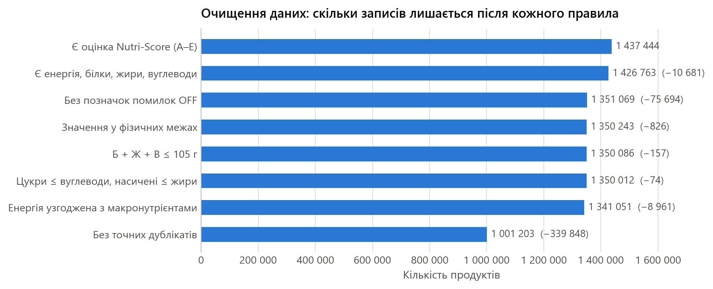

Пояснення до окремих правил:

- **Узгодженість енергії.** Енергію з етикетки порівнюємо з оцінкою за коефіцієнтами Етвотера
  (4 ккал/г для білків і вуглеводів, 9 для жирів, 7 для алкоголю). Допустиме відхилення —
  більше з двох: 50 ккал або 25 % від оцінки. Правило відсіює помилки введення на кшталт
  переплутаних кДж і ккал (`figures/02_energy_consistency.png`).
- **Дублікати.** Запис вважається дублікатом, якщо збігаються всі вісім нутрієнтів (після
  округлення до 0,01) і оцінка. Без цього кроку одна й та сама рецептура, внесена в базу
  кілька разів, потрапляла б і в навчальну, і в тестову вибірку.
- Пороги (950 ккал, 105 г) збігаються з тими, що застосовує сам застосунок у
  `food_db.parse_off_product`.

З 1 001 203 записів 1 920 належать українському ринку.

## 4. Розвідувальний аналіз

**Баланс класів** (`figures/03_class_balance.png`): A — 12,8 %, B — 9,9 %, C — 22,7 %,
D — 26,3 %, E — 28,3 %. Найрідший клас B зустрічається майже втричі рідше за E, тому основною
метрикою обрано macro-F1, а не точність.

**Медіани нутрієнтів за оцінками** (`figures/04_features_by_grade.png`):

| Оцінка | ккал | Білки | Жири | Вуглеводи | Цукри | Насичені жири | Клітковина | Сіль |
|---|---:|---:|---:|---:|---:|---:|---:|---:|
| A | 112 | 10,0 | 1,6 | 8,2 | 1,8 | 0,3 | 2,6 | 0,10 |
| B | 106 | 4,9 | 2,1 | 8,7 | 1,9 | 0,5 | 1,2 | 0,20 |
| C | 150 | 4,7 | 4,5 | 14,3 | 3,5 | 1,3 | 1,6 | 0,70 |
| D | 288 | 7,2 | 13,0 | 25,4 | 4,4 | 3,6 | 1,5 | 1,04 |
| E | 409 | 6,0 | 21,2 | 47,0 | 24,2 | 9,0 | 1,4 | 0,62 |

Енергія, жири, насичені жири й цукри зростають від A до E монотонно. Сіль поводиться інакше:
її медіана найвища в D, бо клас E значною мірою складається із солодощів.

**Зв'язок ознак з оцінкою** (`figures/06_correlation.png`):

| Ознака | Кореляція Спірмена з оцінкою | Взаємна інформація |
|---|---:|---:|
| Насичені жири | 0,511 | 0,253 |
| Енергія | 0,498 | 0,249 |
| Жири | 0,435 | 0,230 |
| Цукри | 0,411 | 0,202 |
| Сіль | 0,299 | 0,179 |
| Вуглеводи | 0,274 | 0,143 |
| Клітковина | −0,120 | 0,038 |
| Білки | −0,024 | 0,085 |

Поодинці жодна ознака оцінку не визначає; у білків зв'язок немонотонний (кореляція близька
до нуля при ненульовій взаємній інформації).

**Пропуски** (`figures/05_missing_values.png`): клітковина відсутня в 34,6 % записів, насичені
жири — в 1,4 %, цукри — в 0,4 %, сіль — у 46 записах. Частка фруктів/овочів/бобових відома
лише для 46,8 % записів, група продукту — для 82,6 %.

**Групи продуктів** (`figures/07_grade_by_food_group.png`): розподіл оцінок сильно залежить
від групи. Серед солодких снеків 67 % мають E, серед фруктів та овочів 44 % мають A.

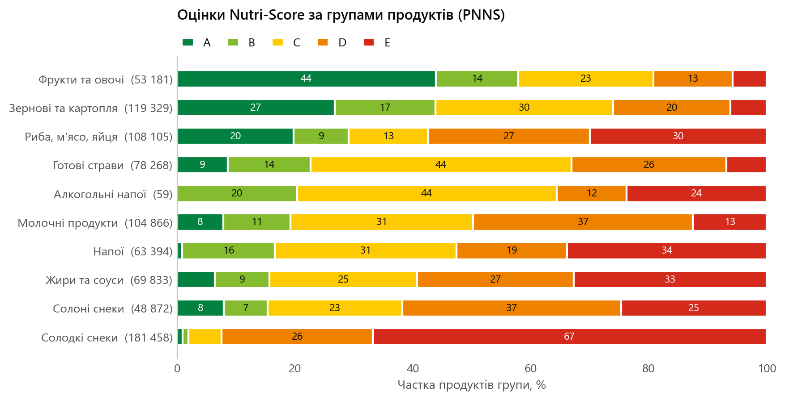

**Неоднозначність міток.** Однаковий набір значень ознак може мати різні оцінки:

| Набір ознак | Записів із неунікальним профілем | Профілів із суперечливими оцінками | Стеля точності при запам'ятовуванні |
|---|---:|---:|---:|
| 4 макронутрієнти | 39,4 % | 39,0 % | 91,5 % |
| 8 полів етикетки | 2,3 % | 100 %* | 98,8 % |

\* Після видалення дублікатів однакові вісім полів можуть лишитися тільки в записів із різними
оцінками.

Стеля — це точність моделі, яка запам'ятала б найчастішу оцінку кожного профілю. На чотирьох
макронутрієнтах навіть така модель помилялася б у 8,5 % випадків: інформації в них об'єктивно
бракує (`figures/08_macro_space.png`).

## 5. Методика

**Розбиття.** Train / validation / test = 70 / 15 / 15 %: 700 744 / 150 336 / 150 123 записи.
Частина визначається хешем профілю нутрієнтів, тому розбиття детерміноване, а продукти з
однаковими вісьмома полями завжди потрапляють в одну частину. Частки класів у трьох частинах
збігаються з точністю до 0,2 в. п.

**Моделі.**

| Модель | Роль | Обробка пропусків |
|---|---|---|
| Базова (частоти класів) | нижня межа: завжди найчастіший клас | — |
| Логістична регресія | лінійна модель | медіана + індикатор пропуску, стандартизація |
| Random Forest | ансамбль незалежних дерев | вбудована |
| LightGBM | градієнтний бустинг | вбудована |
| Формула Nutri-Score 2023 | еталон без навчання (розділ 7) | пропуск = 0 |

**Протокол, однаковий для всіх моделей.**

1. Гіперпараметри підбираються на підвибірці 200 000 записів із навчальної частини,
   3-кратна стратифікована крос-валідація, критерій — macro-F1. Логістична регресія: повна
   сітка з 8 конфігурацій; Random Forest: 10 випадкових конфігурацій; LightGBM: 15.
2. Найкраща конфігурація навчається на всій навчальній частині. LightGBM зупиняється за
   валідаційною частиною (до 4000 ітерацій, крок 0,05, терпіння 100 ітерацій).
3. Тестова частина використовується один раз, для чисел у цьому звіті.

**Метрики.**

- **Точність** — частка правильних оцінок.
- **Macro-F1** — середнє F1 по п'яти класах; основна метрика через дисбаланс.
- **QWK** (квадратично зважена каппа Коена) враховує порядок класів: помилка A→E штрафується
  сильніше, ніж A→B.
- **MAE в оцінках** — середня відстань між передбаченою і справжньою оцінкою.
- **±1** — частка відповідей, що збіглися або відрізняються на одну оцінку.
- **95 % довірчі інтервали** — бутстреп тестової вибірки, 1000 повторів.
- **Тест Мак-Немара** — чи значуща різниця між двома моделями на тих самих продуктах.

**Середовище.** Intel Core i5-12450H (12 потоків), 16 ГБ ОЗП, Windows 11, Python 3.12,
scikit-learn 1.7.2, LightGBM 4.7.0, SHAP 0.49.1. Навчання на CPU. Зерно генератора — 42.

## 6. Порівняння моделей

Тестова вибірка, 150 123 продукти (`results/metrics_macros.json`, `results/metrics_label.json`).

**4 макронутрієнти**

| Модель | Точність | Macro-F1 | QWK | MAE | ±1 |
|---|---:|---:|---:|---:|---:|
| Базова | 0,2831 | 0,0883 | 0,0000 | 1,527 | 0,5448 |
| Логістична регресія | 0,3838 | 0,3518 | 0,4870 | 1,020 | 0,7460 |
| Random Forest | 0,6087 | 0,5840 | 0,7082 | 0,581 | 0,8703 |
| **LightGBM** | **0,6203** | **0,5852** | **0,7129** | **0,554** | **0,8759** |

**8 полів етикетки**

| Модель | Точність | Macro-F1 | QWK | MAE | ±1 |
|---|---:|---:|---:|---:|---:|
| Базова | 0,2831 | 0,0883 | 0,0000 | 1,527 | 0,5448 |
| Логістична регресія | 0,6832 | 0,6585 | 0,8452 | 0,391 | 0,9367 |
| Формула Nutri-Score | 0,8159 | 0,7840 | 0,8752 | 0,264 | 0,9317 |
| Random Forest | 0,8729 | 0,8494 | 0,9240 | 0,170 | 0,9653 |
| **LightGBM** | **0,8913** | **0,8700** | **0,9345** | **0,146** | **0,9695** |

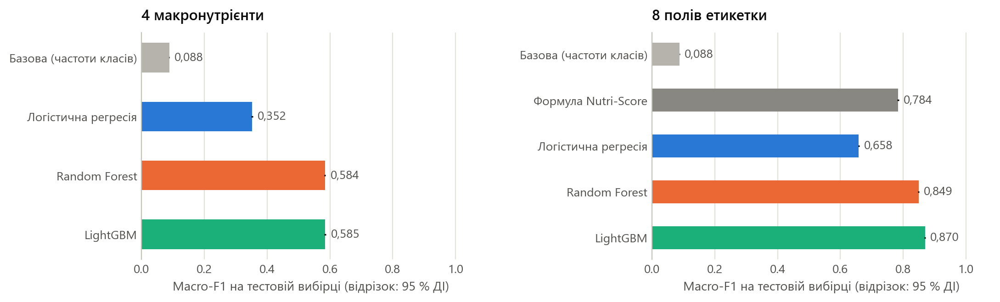

**Довірчі інтервали (95 %)**

| Модель, набір ознак | Точність | Macro-F1 |
|---|---|---|
| LightGBM, 8 полів | 0,8898–0,8930 | 0,8681–0,8718 |
| Random Forest, 8 полів | 0,8712–0,8746 | 0,8474–0,8514 |
| Формула, 8 полів | 0,8140–0,8177 | 0,7818–0,7863 |
| Логістична регресія, 8 полів | 0,6809–0,6855 | 0,6561–0,6610 |
| LightGBM, 4 макронутрієнти | 0,6177–0,6230 | 0,5823–0,5881 |
| Random Forest, 4 макронутрієнти | 0,6061–0,6112 | 0,5813–0,5867 |

**Тест Мак-Немара** (скільки продуктів правильно оцінила лише одна з двох моделей)

| Пара | Лише перша | Лише друга | χ² | p |
|---|---:|---:|---:|---|
| LightGBM vs Random Forest, 8 полів | 5 667 | 2 900 | 893,1 | 3·10⁻¹⁹⁶ |
| Random Forest vs LogReg, 8 полів | 34 091 | 5 616 | 20 418,8 | < 10⁻³⁰⁰ |
| LightGBM vs Random Forest, 4 макро | 8 790 | 7 037 | 193,9 | 4·10⁻⁴⁴ |
| Random Forest vs LogReg, 4 макро | 46 200 | 12 442 | 19 432,1 | < 10⁻³⁰⁰ |

Що з цього випливає:

- **Набір ознак важить більше, ніж алгоритм.** Перехід від 4 до 8 полів додає LightGBM
  27,1 в. п. точності, тоді як заміна логістичної регресії на LightGBM на тих самих 8 полях —
  20,8 в. п.
- **Залежність нелінійна.** Логістична регресія на 8 полях (68,3 %) програє навіть формулі
  (81,6 %): оцінка побудована на порогах і взаємодіях, яких лінійна модель не відтворює.
- **LightGBM кращий за Random Forest на 8 полях** за всіма метриками, інтервали не
  перетинаються. На 4 макронутрієнтах різниця в точності значуща (1,2 в. п.), але macro-F1
  практично однаковий (0,585 проти 0,584): обидві моделі впираються в нестачу інформації.
- Результати на валідації та тесті збігаються в межах 0,3 в. п. (LightGBM, 8 полів:
  0,8923 і 0,8913), тобто перенавчання на валідаційну частину немає.

**Якість за класами** (LightGBM, 8 полів; `figures/11_per_class_f1.png`)

| Оцінка | Precision | Recall | F1 | Записів |
|---|---:|---:|---:|---:|
| A | 0,844 | 0,870 | 0,857 | 19 200 |
| B | 0,721 | 0,794 | 0,756 | 14 872 |
| C | 0,878 | 0,850 | 0,864 | 34 258 |
| D | 0,929 | 0,920 | 0,924 | 39 293 |
| E | 0,956 | 0,942 | 0,949 | 42 500 |

Найважчий клас — B: він найрідший і затиснутий між A та C. Матриці помилок
(`figures/10_confusion_label.png`, `figures/10_confusion_macros.png`) показують, що помилки
зосереджені в сусідніх класах.

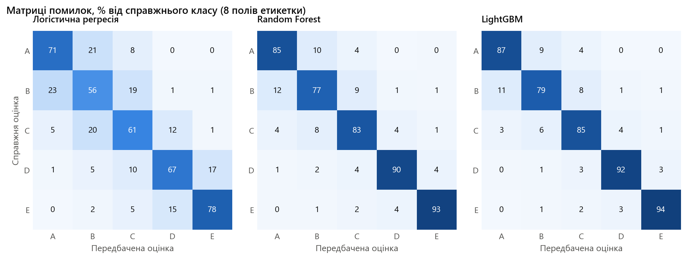

**Найкращі гіперпараметри**

| Модель | 4 макронутрієнти | 8 полів етикетки |
|---|---|---|
| Логістична регресія | C = 1, збалансовані ваги класів | C = 1, збалансовані ваги класів |
| Random Forest | глибина 18, мін. листок 10, 60 % ознак на розбиття, збалансовані ваги | глибина 18, мін. листок 5, усі ознаки, збалансовані ваги |
| LightGBM | 127 листків, мін. 200 записів у листку, без субвибірки, 1766 ітерацій | 127 листків, мін. 20 записів у листку, субвибірка 0,85, 80 % ознак, L2 = 1, збалансовані ваги, 2199 ітерацій |

Macro-F1 на крос-валідації (підвибірка 200 тис.): 8 полів — 0,658 / 0,826 / 0,842 для
логістичної регресії, Random Forest і LightGBM; 4 макронутрієнти — 0,353 / 0,565 / 0,562.
Розкид між фолдами не перевищує 0,003.

**Вартість моделей**

| Модель, набір ознак | Підбір, с | Навчання, с | Файл моделі | Одна відповідь, мс |
|---|---:|---:|---:|---:|
| Логістична регресія, 4 макро | 22 | 4 | 1,5 КБ | 1,0 |
| Random Forest, 4 макро | 204 | 50 | 275 МБ | 33,0 |
| LightGBM, 4 макро | 701 | 184 | 52,5 МБ | 3,5 |
| Логістична регресія, 8 полів | 78 | 17 | 2,1 КБ | 1,5 |
| Random Forest, 8 полів | 398 | 210 | 156,8 МБ | 37,9 |
| LightGBM, 8 полів | 869 | 274 | 65,3 МБ | 6,3 |

Файл моделі — joblib зі стисненням. «Одна відповідь» — час передбачення для одного продукту,
як у вебзастосунку. Random Forest програє LightGBM і за якістю, і за розміром, і за швидкістю.

## 7. Формула Nutri-Score як еталон

`formula.py` реалізує офіційний алгоритм у редакції 2023 року для загальних продуктів.
Етикетка не містить ні частки фруктів/овочів/бобових, ні категорії, тому еталон оцінює кожен
продукт як загальний із нульовою часткою. Енергію він бере так само, як її має Kolos:
ккал × 4,184.

**Перевірка реалізації.** На 179 034 загальних продуктах із відомою часткою
фруктів/овочів/бобових і всіма полями етикетки бали порівняно з опублікованими в OFF.

| Варіант | Бал збігся точно | Бал у межах ±1 | Оцінка збіглась |
|---|---:|---:|---:|
| кДж з етикетки | 92,8 % | 95,3 % | 96,4 % |
| кДж = ккал × 4,184 | 86,4 % | 95,0 % | 95,3 % |

Причини розбіжностей:

- **Енергія.** OFF рахує бали за кДж з етикетки. Виробники обчислюють кДж і ккал окремо
  (17/37 кДж і 4/9 ккал на грам), тому перерахунок через 4,184 зсуває значення через поріг
  приблизно в 7 % продуктів.
- **Частка фруктів, овочів і бобових.** У групах зі сталим складом бал збігається майже
  завжди: шоколадні вироби — 99,4 %, випічка — 99,4 %, печиво й тістечка — 99,1 %,
  картопля — 99,0 %, хліб — 98,2 %. Розбіжності зосереджені там, де OFF оцінює цю частку за
  складом продукту: бобові — 35,9 % збігів (у середньому наш бал вищий на 3,1), крупи —
  77,4 %.

Тобто таблиці балів реалізовано правильно, а залишкова розбіжність пояснюється вхідними
даними, яких у дампі немає.

**Еталон проти моделі.** Без знання категорії формула дає 81,6 % точності, LightGBM на тих
самих полях — 89,1 %. Модель виграє там, де діють окремі правила (розділ 10): вона розпізнає
напої, сири чи олії за характерним профілем нутрієнтів.

## 8. Додаткові експерименти

### 8.1. Абляція ознак

Одна конфігурація LightGBM (параметри з розділу 6 для 8 полів, крок 0,1), змінюється лише
набір ознак (`results/ablation.json`). Через більший крок базові значення трохи відрізняються
від розділу 6.

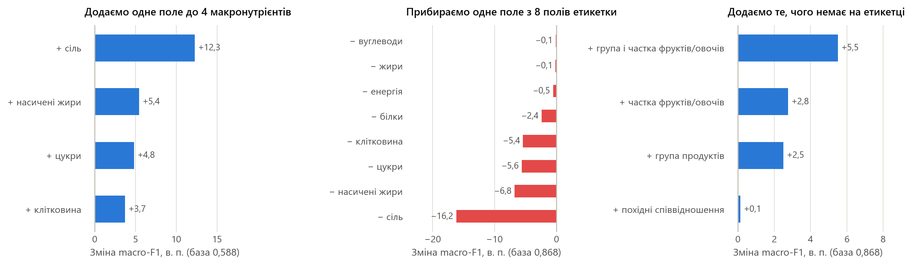

| Варіант | Точність | Macro-F1 | Зміна macro-F1, в. п. |
|---|---:|---:|---:|
| 4 макронутрієнти (база) | 0,6121 | 0,5879 | — |
| + сіль | 0,7349 | 0,7106 | +12,3 |
| + насичені жири | 0,6714 | 0,6423 | +5,4 |
| + цукри | 0,6606 | 0,6360 | +4,8 |
| + клітковина | 0,6458 | 0,6249 | +3,7 |
| 8 полів етикетки (база) | 0,8898 | 0,8681 | — |
| − сіль | 0,7319 | 0,7063 | −16,2 |
| − насичені жири | 0,8190 | 0,8005 | −6,8 |
| − цукри | 0,8327 | 0,8119 | −5,6 |
| − клітковина | 0,8423 | 0,8142 | −5,4 |
| − білки | 0,8728 | 0,8442 | −2,4 |
| − енергія | 0,8846 | 0,8629 | −0,5 |
| − жири | 0,8887 | 0,8668 | −0,1 |
| − вуглеводи | 0,8886 | 0,8670 | −0,1 |
| 8 полів + похідні співвідношення | 0,8908 | 0,8694 | +0,1 |
| 8 полів + група продуктів | 0,9119 | 0,8932 | +2,5 |
| 8 полів + частка фруктів/овочів | 0,9123 | 0,8957 | +2,8 |
| 8 полів + група + частка фруктів/овочів | 0,9366 | 0,9232 | +5,5 |

- **Сіль — найцінніше поле.** Вона одна додає до макронутрієнтів 12,3 в. п., а без неї
  модель на етикетці втрачає 16,2 в. п. Сіль не можна вивести з інших полів.
- **Жири, вуглеводи й енергія взаємозамінні:** прибирання будь-якого з них майже нічого не
  змінює, бо енергія обчислюється з макронутрієнтів.
- **Похідні співвідношення нічого не дають** (+0,1 в. п.): дерева самі будують такі
  комбінації.
- **Те, чого немає на етикетці, додало б ще 5,5 в. п.** Це і є ціна відсутності категорії та
  частки фруктів/овочів.

### 8.2. Криві навчання

Macro-F1 на валідації залежно від розміру навчальної вибірки (`results/learning_curves.json`).

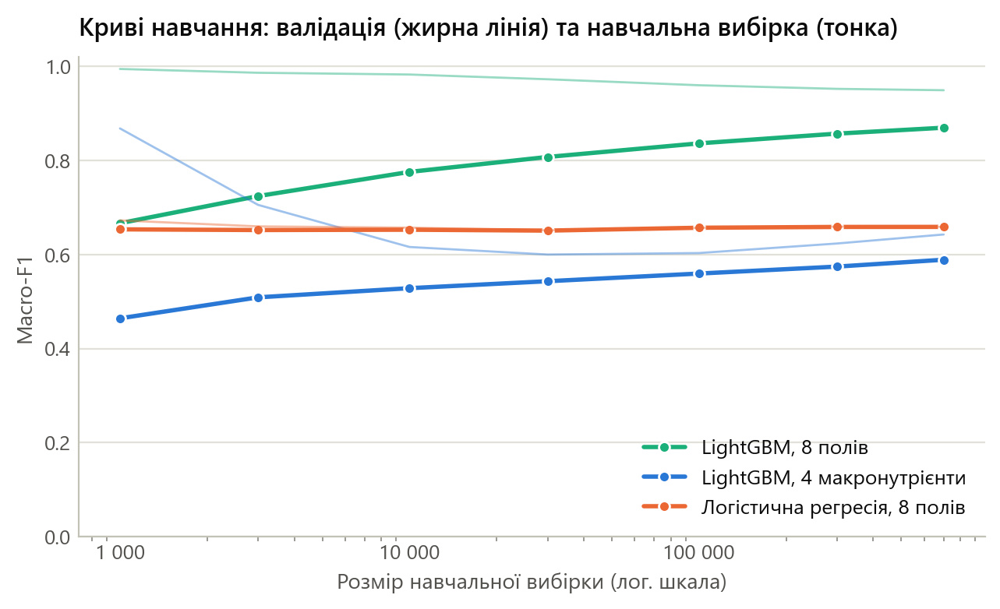

| Записів | LightGBM, 8 полів | LightGBM, 4 макро | LogReg, 8 полів |
|---:|---:|---:|---:|
| 1 000 | 0,667 | 0,464 | 0,654 |
| 10 000 | 0,776 | 0,528 | 0,653 |
| 100 000 | 0,836 | 0,560 | 0,657 |
| 300 000 | 0,857 | 0,574 | 0,659 |
| 700 744 | 0,870 | 0,589 | 0,659 |

- Логістична регресія виходить на плато вже на тисячі записів: це обмеження самої моделі,
  дані його не знімають.
- LightGBM продовжує зростати: збільшення вибірки з 300 до 700 тис. додало 1,3 в. п. Більше
  даних ще трохи підняло б якість.
- Розрив між навчальною та валідаційною кривими для LightGBM на 8 полях (0,949 проти 0,870)
  показує, що модель частково запам'ятовує навчальні приклади; рання зупинка тримає це під
  контролем.

### 8.3. Розмір моделі проти точності

Навчену модель LightGBM можна обрізати до перших k ітерацій без перенавчання
(`results/compact_models.json`). Розмір — текстовий формат LightGBM без стиснення.

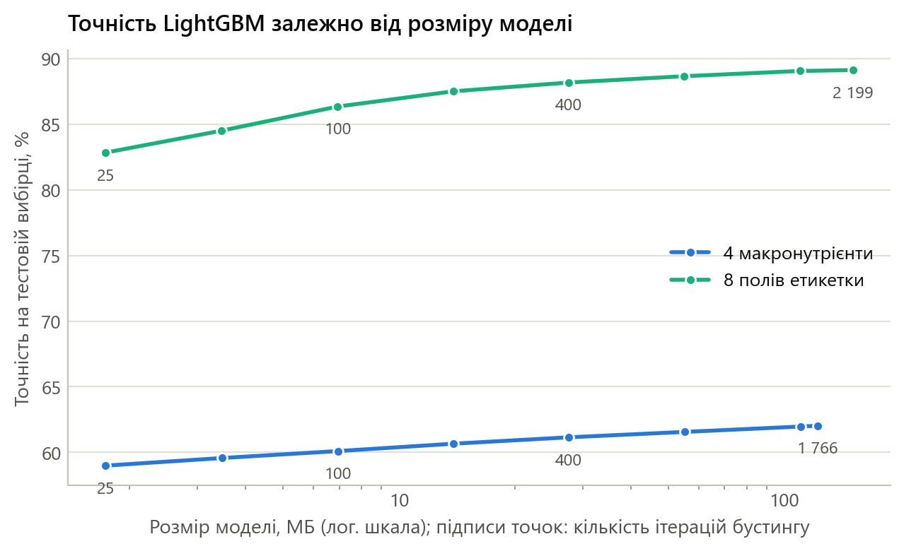

| Ітерацій | Розмір, МБ | Одна відповідь, мс | Точність, 8 полів | Точність, 4 макро |
|---:|---:|---:|---:|---:|
| 25 | 1,7 | 0,9 | 0,8284 | 0,5899 |
| 50 | 3,5 | 1,1 | 0,8451 | 0,5957 |
| 100 | 6,9 | 1,1 | 0,8635 | 0,6010 |
| 200 | 13,8 | 1,5 | 0,8751 | 0,6066 |
| 400 | 27,6 | 1,8 | 0,8818 | 0,6115 |
| 800 | 54,9 | 2,6 | 0,8866 | 0,6156 |
| повна (2199 / 1766) | 150,8 / 122,0 | 5,0 / 4,9 | 0,8913 | 0,6203 |

Модель із 200 ітерацій у 11 разів менша за повну і втрачає 1,6 в. п. точності; зі 100
ітерацій — у 22 рази менша і втрачає 2,8 в. п. Навіть модель із 25 ітерацій (1,7 МБ) точніша
за формулу.

## 9. Інтерпретація моделі

**SHAP** (TreeExplainer, 5000 продуктів тестової вибірки; `results/explanations.json`).
Сума середніх |SHAP| по п'яти класах:

| Ознака | 8 полів | 4 макронутрієнти |
|---|---:|---:|
| Цукри | 8,98 | — |
| Насичені жири | 8,52 | — |
| Сіль | 8,20 | — |
| Клітковина | 2,87 | — |
| Енергія | 2,39 | 2,74 |
| Білки | 2,21 | 2,99 |
| Вуглеводи | 2,08 | 2,46 |
| Жири | 1,29 | 4,78 |

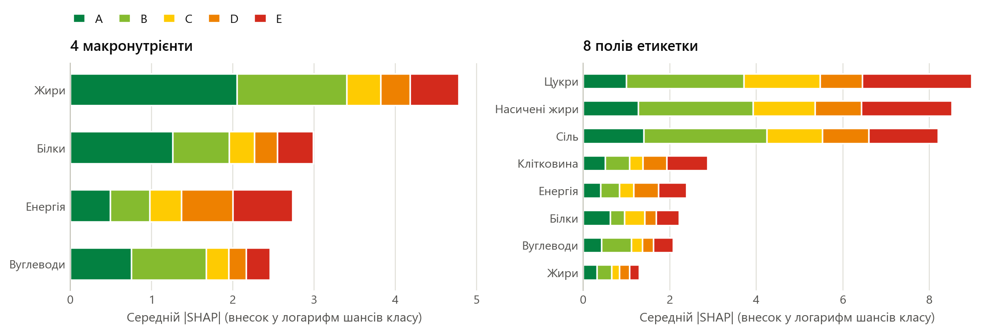

**Перестановочна важливість** (падіння macro-F1 після перемішування ознаки, 20 000 продуктів,
5 повторів):

| Ознака | LightGBM | Random Forest | LogReg |
|---|---:|---:|---:|
| Сіль | 0,401 | 0,382 | 0,253 |
| Насичені жири | 0,347 | 0,334 | 0,220 |
| Цукри | 0,343 | 0,319 | 0,225 |
| Білки | 0,193 | 0,191 | 0,071 |
| Енергія | 0,135 | 0,170 | 0,096 |
| Клітковина | 0,132 | 0,121 | 0,067 |
| Вуглеводи | 0,077 | 0,041 | 0,135 |
| Жири | 0,061 | 0,011 | 0,077 |

Обидва методи й абляція сходяться: модель спирається на цукри, насичені жири й сіль, тобто
на ті самі «негативні» компоненти, за які нараховує бали офіційна формула. Коли цих полів
немає, найважливішою ознакою стають жири — найближчий замінник насичених жирів.

Графік залежності SHAP-внеску від значення ознаки (`figures/15_shap_dependence.png`) показує,
що модель відтворила структуру алгоритму з даних. Внесок цукрів, насичених жирів і солі в
клас E зростає саме в діапазоні порогів офіційної формули й виходить на плато за останнім
порогом (насичені жири — 10 г, сіль — 4 г). Для клітковини видно стрибок на першому порозі
(3 г), після якого внесок у клас E стає від'ємним.

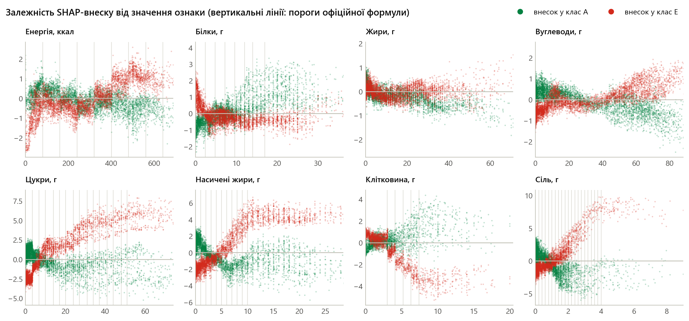

## 10. Надійність і аналіз помилок

### 10.1. Розмір помилки

| Відстань до справжньої оцінки | 8 полів | 4 макронутрієнти |
|---|---:|---:|
| 0 (правильно) | 89,13 % | 62,03 % |
| 1 | 7,81 % | 25,55 % |
| 2 | 2,54 % | 8,53 % |
| 3 | 0,37 % | 2,78 % |
| 4 (A ↔ E) | 0,14 % | 1,11 % |

Модель на 8 полях завищує корисність у 6,3 % випадків і занижує в 4,6 %; на 4
макронутрієнтах — 16,9 % і 21,0 %.

### 10.2. Калібрування та поріг упевненості

Імовірності LightGBM добре відкалібровані: очікувана помилка калібрування (ECE) 0,004 для 8
полів і 0,005 для 4 макронутрієнтів. Тому максимальну ймовірність можна використовувати як
поріг: показувати оцінку лише тоді, коли модель достатньо впевнена.

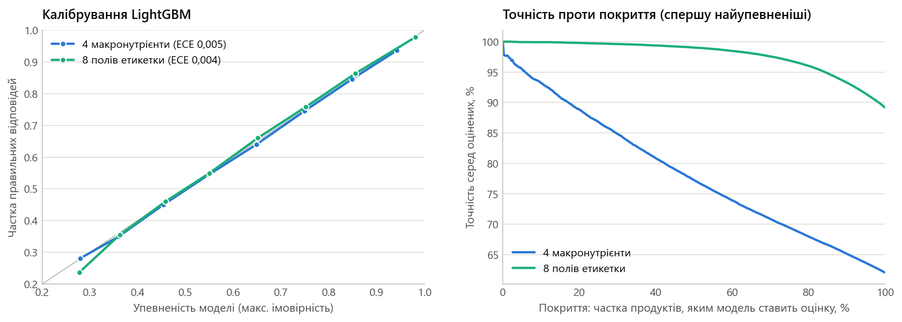

| Мін. упевненість | Покриття, 8 полів | Точність | ±1 | Покриття, 4 макро | Точність | ±1 |
|---:|---:|---:|---:|---:|---:|---:|
| 0 (усі) | 100 % | 89,1 % | 97,0 % | 100 % | 62,0 % | 87,6 % |
| 0,5 | 96,7 % | 90,7 % | 97,7 % | 70,9 % | 70,6 % | 92,5 % |
| 0,6 | 91,3 % | 92,8 % | 98,2 % | 51,1 % | 76,9 % | 94,3 % |
| 0,7 | 85,6 % | 94,6 % | 98,7 % | 34,8 % | 82,9 % | 96,1 % |
| 0,8 | 78,8 % | 96,2 % | 99,1 % | 20,9 % | 88,5 % | 97,4 % |
| 0,9 | 68,4 % | 97,8 % | 99,5 % | 9,0 % | 93,6 % | 98,5 % |

Ті самі пороги на валідаційній частині дають покриття й точність у межах 0,3 в. п., тож поріг
можна обирати на валідації.

### 10.3. Точність за групами продуктів

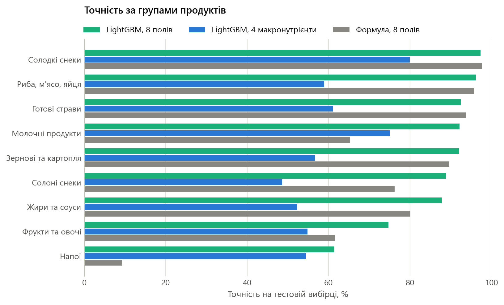

| Група | Записів у тесті | LightGBM, 4 макро | LightGBM, 8 полів | Формула, 8 полів |
|---|---:|---:|---:|---:|
| Солодкі снеки | 27 258 | 79,9 % | 97,3 % | 97,7 % |
| Риба, м'ясо, яйця | 16 090 | 58,9 % | 96,2 % | 95,8 % |
| Готові страви | 11 590 | 61,1 % | 92,4 % | 93,7 % |
| Молочні продукти | 15 575 | 75,0 % | 92,2 % | 65,3 % |
| Зернові та картопля | 17 919 | 56,6 % | 92,1 % | 89,6 % |
| Солоні снеки | 7 341 | 48,6 % | 88,8 % | 76,2 % |
| Жири та соуси | 10 479 | 52,2 % | 87,9 % | 80,1 % |
| Фрукти та овочі | 8 102 | 54,8 % | 74,7 % | 61,6 % |
| Напої | 9 428 | 54,5 % | 61,4 % | 9,3 % |
| Без групи | 26 334 | 54,4 % | 86,1 % | 89,2 % |

- Там, де діють загальні правила (солодощі, м'ясо, готові страви), модель і формула
  рівноцінні.
- Модель значно краща там, де є окремі правила: молочні продукти (+26,9 в. п.), солоні снеки
  з горіхами (+12,6), жири та соуси (+7,8), напої (+52,1).
- **Слабкі місця моделі — напої (61,4 %) та фрукти й овочі (74,7 %).** Напої оцінюються за
  зовсім іншою шкалою, а відрізнити напій від рідкої страви за нутрієнтами вдається не
  завжди. Для фруктів та овочів вирішальна їхня частка в продукті, якої на етикетці немає.

### 10.4. Український ринок

У тестовій вибірці 285 українських продуктів.

| Набір ознак | Точність | Macro-F1 | QWK | ±1 |
|---|---:|---:|---:|---:|
| 8 полів | 89,5 % | 0,871 | 0,947 | 98,9 % |
| 4 макронутрієнти | 66,3 % | 0,641 | 0,782 | 90,5 % |

Якість на українських продуктах не гірша за загальну. Вибірка мала, тому похибка цих оцінок
становить кілька відсоткових пунктів.

### 10.5. Грубі помилки з високою впевненістю

П'ятнадцять найупевненіших помилок на три й більше оцінок збережено в
`results/error_analysis.json`. Для моделі на 8 полях це здебільшого помилки в самих даних
OFF, а не моделі:

| Продукт | Група в OFF | Оцінка в OFF | Модель | Нутрієнти на 100 г |
|---|---|---|---|---|
| Chocolat Milka | напої | A | E | 527 ккал, цукри 57 г, насичені жири 18 г |
| Eti Schokolade mit Pistazien | солодкі снеки | A | E | 532 ккал, цукри 39 г, насичені жири 18,8 г |
| Feiner Rührkuchen Stracciatella | солодкі снеки | A | E | 450 ккал, цукри 28 г |
| Água Mineral Natural Gasocarbónica | напої | A | E | 331 ккал, жири 21 г, цукри 29 г |
| Sauce pour nem | жири та соуси | A | E | цукри 48 г, сіль 6,2 г |

Шоколад з оцінкою A чи мінеральна вода з 331 ккал — це хибна категорія або нутрієнти, внесені
не до того продукту. Такий шум у мітках обмежує досяжну точність зверху, і частина «помилок»
моделі насправді є правильними відповідями.

Для моделі на 4 макронутрієнтах грубі помилки справжні й пояснюються браком інформації:
солона риба (сіль 4–24 г) або рибний соус виглядають за макронутрієнтами як нежирне джерело
білка й отримують A замість E.

## 11. Висновки

1. **Задача розв'язується добре за наявності повної етикетки.** LightGBM на 8 полях: точність
   89,1 %, macro-F1 0,870, QWK 0,9345; 97,0 % відповідей збігаються зі справжньою оцінкою або
   відрізняються на одну.
2. **Модель точніша за формулу без категорії** на 7,5 в. п., бо відновлює категорію з профілю
   нутрієнтів. Найбільший виграш — молочні продукти та напої.
3. **Чотирьох макронутрієнтів недостатньо** для надійної оцінки: 62,0 % точності, і навіть
   запам'ятовування дало б не більше 91,5 %. Бракує передусім солі, насичених жирів і цукрів.
4. **Порядок алгоритмів** однаковий на обох наборах: LightGBM ≥ Random Forest ≫ логістична
   регресія ≫ базова модель. Random Forest до того ж у 2,4–5,2 раза більший і в 6–9 разів
   повільніший на одному продукті.
5. **Модель відкалібрована** (ECE 0,004), тому поріг упевненості дає керований компроміс:
   при порозі 0,7 модель на 8 полях оцінює 85,6 % продуктів із точністю 94,6 %.
6. **Компактна версія майже не втрачає якості:** 200 ітерацій — 13,8 МБ і 87,5 %.

**Рекомендація для застосунку.** Використовувати LightGBM на 8 полях, обрізаний до 100–200
ітерацій, і показувати оцінку з позначкою, що вона передбачена моделлю. Для цього в `Product`
потрібні цукри, насичені жири, клітковина й сіль. Для продуктів, де є лише макронутрієнти,
оцінку або не показувати, або показувати модель на 4 макронутрієнтах лише за високої
впевненості (при порозі 0,8 вона охоплює 20,9 % продуктів із точністю 88,5 %).

## 12. Обмеження

- **Цільова змінна — це оцінка OFF**, обчислена алгоритмом із даних, внесених волонтерами.
  Модель наближає алгоритм із прихованими входами і успадковує шум міток (розділ 10.5).
- **Географічний зсув.** База OFF наповнена переважно західноєвропейськими й американськими
  продуктами; українських записів 1 920 (0,2 %).
- **Обмежений пошук гіперпараметрів:** 10–15 випадкових конфігурацій на підвибірці 200 тис.
  Ширший пошук міг би додати ще трохи якості.
- **Клітковина відсутня в 34,6 % записів.** Деревні моделі обробляють пропуск як окреме
  значення; у застосунку продукт без клітковини оцінюватиметься так само.
- **Еталонна формула спрощена** до загальних продуктів із нульовою часткою фруктів і овочів.
  Це свідоме рішення, щоб порівнювати її з моделлю на однакових вхідних даних.
- **Алкогольні напої** майже не представлені (59 записів), їх оцінювати не слід.

## 13. Модель у застосунку

Для Kolos навчено окремі компактні моделі (`export.py`): ті самі підібрані параметри LightGBM,
крок 0,2 і 200 ітерацій. Окреме навчання з більшим кроком на валідації дало на 1 в. п. більше,
ніж обрізання повної моделі до того ж розміру. Результати на тестовій вибірці
(`results/export.json`):

| Модель | Точність | Macro-F1 | QWK | ±1 | Файл (gzip) | Одна відповідь |
|---|---:|---:|---:|---:|---:|---:|
| 8 полів етикетки | 88,4 % | 0,862 | 0,931 | 96,8 % | 5,7 МБ | 1,1 мс |
| 4 макронутрієнти | 61,6 % | 0,579 | 0,707 | 87,4 % | 5,6 МБ | 0,9 мс |

Порівняно з повною моделлю (89,1 %, 65 МБ) компактна на 8 полях втрачає 0,7 в. п.

**Як застосунок обирає відповідь** (`score_model.py`):

1. Оцінка з Open Food Facts, якщо вона є, завжди має пріоритет.
2. Якщо відомі цукри, насичені жири й сіль (клітковина може бути невідома, як і в навчальних
   даних), відповідає модель на 8 полях.
3. Якщо відомі лише макронутрієнти, відповідає модель на 4 макронутрієнтах, але тільки коли її
   впевненість не нижча за 0,79. Поріг підібрано на валідації як найменший, за якого точність
   сягає 88 %. На тесті він дає покриття 20,3 % продуктів із точністю 88,1 % (±1 — 97,3 %).
   Решта таких продуктів лишається без оцінки: хибна оцінка гірша, ніж жодної.

Передбачена оцінка позначається в інтерфейсі пунктирною рамкою й підписом «передбачено Kolos».
Поля етикетки беруться з Open Food Facts автоматично (сіль за потреби рахується з натрію,
× 2,5), а у формі власного продукту їх можна ввести в розділі «Більше з етикетки».

**Вбудований каталог.** 160 базових продуктів Kolos не мають оцінки з OFF. Їхні поля етикетки
взято з тих самих записів USDA FoodData Central (SR Legacy), що й мікроелементи
(`tools/build_usda_micros.py`): цукри, насичені жири, клітковина, а сіль — натрій × 2,5.
USDA не наводить 10 значень для 7 продуктів (цукри картоплі фрі, млинців, скумбрії, креветок,
тофу, темпе й чіа; клітковина млинців, креветок і темпе). Їх заповнено наближено, з указаним
джерелом (`usda_micros.LABEL_ESTIMATED`): за близьким записом USDA, перерахованим на наші
вуглеводи, або медіаною того самого продукту в OFF (126 темпе, 194 насіння чіа). Для 12
молочних та яєчних продуктів цукри з USDA трохи перевищують наші вуглеводи (через округлення
й інший запис; у сиру кисломолочного — 4,0 г проти 1,8 г). Тому під час заповнення частина
обмежується цілим: цукри й клітковина ≤ вуглеводи, насичені жири ≤ жири.

У результаті всі 160 продуктів оцінює модель на 8 полях. Раніше, лише з макронутрієнтами,
оцінку отримували 26 продуктів. Розподіл: A — 82, B — 31, C — 16, D — 20, E — 11. Справжніх
оцінок для цих продуктів немає, тож для перевірки їх порівняно із загальною формулою
Nutri-Score (без частки фруктів/овочів/горіхів і без окремих правил для жирів і напоїв). Оцінки
збігаються у 109 зі 160 продуктів, а з точністю до однієї — у 143. Усі 17 більших розбіжностей
припадають саме на випадки, які спрощена формула не враховує: фрукти й горіхи (банан, яблуко,
мигдаль: формула C, модель A), олії (оливкова: формула E, модель B) і солодкий напій (кола:
формула B, модель E). В усіх них модель ближча до офіційного алгоритму, бо навчалася на
оцінках, які OFF рахує з урахуванням цих правил.

## 14. Відтворення

```bash
pip install -r ml/requirements.txt
python -m ml.nutriscore.extract       # дамп → оцінені продукти
python -m ml.nutriscore.prepare       # очищення і розбиття
python -m ml.nutriscore.eda           # графіки 01–08
python -m ml.nutriscore.train         # підбір, навчання, порівняння (≈1 год)
python -m ml.nutriscore.formula       # еталонна формула
python -m ml.nutriscore.experiments   # абляція, криві навчання, компактні моделі (≈1 год)
python -m ml.nutriscore.analyze       # графіки 09–18, SHAP, аналіз помилок (≈20 хв)
python -m ml.nutriscore.export        # компактні моделі для застосунку → instance/models/nutriscore/
```

| Файл у `results/` | Що містить |
|---|---|
| `extract_stats.json` | розмір дампу, кількість оцінених продуктів |
| `cleaning_funnel.json` | воронка очищення, розміри частин, частки пропусків |
| `eda_stats.json` | розподіли, медіани, кореляції, неоднозначність міток |
| `metrics_macros.json`, `metrics_label.json` | усі метрики, довірчі інтервали, перебрані конфігурації, тест Мак-Немара, вартість |
| `formula_baseline.json` | перевірка формули проти OFF і її метрики |
| `ablation.json`, `learning_curves.json`, `compact_models.json` | додаткові експерименти |
| `explanations.json` | SHAP і перестановочна важливість |
| `export.json` | компактні моделі для застосунку: метрики, поріг упевненості, розмір |
| `accuracy_by_group.json`, `error_analysis.json` | точність за групами, калібрування, покриття, грубі помилки |

Дамп і навчені моделі в репозиторій не входять (`ml/data/`, `ml/models/` у `.gitignore`).
